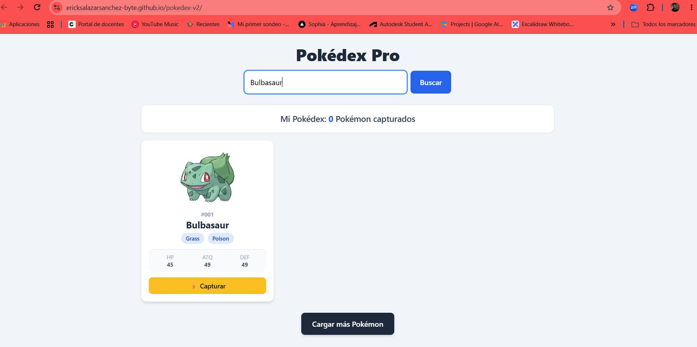
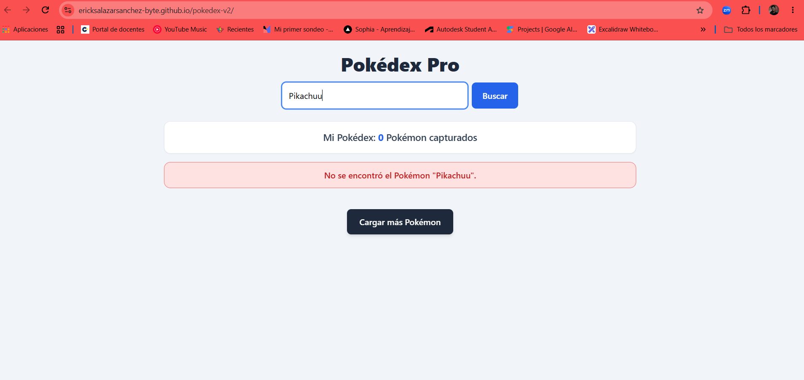

# Pokédex Pro - Aplicación Web Interactiva (Módulo 3)

Buscador de Pokémon dinámico y profesional desarrollado en JavaScript moderno (ES6+) que consume la API REST oficial **PokeAPI**. La aplicación incluye renderizado dinámico del DOM, asincronía con `async/await`, manejo robusto de errores HTTP (`404`) y estados visuales de UI (spinner de carga y mensajes dinámicos).

## 🚀 Enlace al Proyecto Desplegado
[Ver Pokédex Pro en GitHub Pages](https://ericksalazarsanchez-byte.github.io/pokedex-v2/)

---

## 📸 Capturas de la Aplicación en Funcionamiento

### Estado Exitoso: Búsqueda y Renderizado Dinámico

### Estado de Error: Detección de 404 y Botón Reintentar

---

## 📋 Historias de Usuario Implementadas

### HU1: Manejo de Errores Asíncronos con try/catch
**Como** usuario de la Pokédex,  
**quiero** ver un mensaje claro de aviso cuando ocurra un problema de red o de búsqueda,  
**para** evitar que la aplicación se rompa o se quede congelada y poder seguir interactuando con ella.

* **Criterios de Aceptación:**
  * Si la petición a la API falla por red o conexión, la pantalla muestra una alerta legible en lugar de arrojar un error de consola.
  * La aplicación se mantiene operativa en todo momento sin requerir recargar la página web (`F5`).
  * La lógica de red está envuelta en un bloque `try/catch/finally`.

---

### HU2: Detección de Recurso No Encontrado (404) con throw
**Como** usuario de la Pokédex,  
**quiero** recibir una notificación explícita cuando busque un Pokémon inexistente (ej. "pikachuu"),  
**para** saber con exactitud que el nombre o ID ingresado no coincide con ningún registro de PokeAPI.

* **Criterios de Aceptación:**
  * El sistema evalúa si `response.ok` es `false` antes de intentar convertir la respuesta a JSON.
  * Se lanza una excepción propia con `throw new Error()` especificando el término buscado.
  * El mensaje mostrado es dinámico y personalizado (ej. *"No se encontró el Pokémon 'pikachuu'"*).

---

### HU3: Estado de Carga Visual con Spinner Animado de Tailwind
**Como** usuario de la Pokédex,  
**quiero** visualizar un indicador animado mientras se obtienen los datos de la web,  
**para** saber que la aplicación está procesando la solicitud y tener una buena experiencia visual.

* **Criterios de Aceptación:**
  * Al iniciar cualquier consulta asíncrona se muestra un spinner animado con la clase `animate-spin` de Tailwind CSS.
  * El indicador visual se oculta obligatoriamente dentro de un bloque `finally`, garantizando que desaparezca tanto en éxito como en fallo.
  * Si la carga inicial de la Pokédex falla, también se oculta el spinner y se informa al usuario.

---

### HU4: Botón de Reintento de Búsqueda tras Error (Reto Adicional)
**Como** usuario afectado por un fallo de conexión o búsqueda,  
**quiero** presionar un botón de "Reintentar" directamente en la alerta de error,  
**para** ejecutar nuevamente la última búsqueda fallida de manera rápida y sin volver a escribir el texto.

* **Criterios de Aceptación:**
  * Tras un error de red o consulta, aparece dinámicamente el botón `#btn-reintentar`.
  * Al hacer clic en el botón, la app invoca nuevamente a `buscarPokemonEnAPI()` usando la variable `ultimaBusqueda`.
  * Si la nueva consulta es exitosa, el botón de reintento y la alerta se ocultan automáticamente.

---

## 🛠️ Tecnologías Utilizadas
* **JavaScript Moderno (ES6+):** `fetch`, `async/await`, `Promise.all`, `try/catch/finally`, `throw new Error`, `map()`, `filter()`, `find()`, destructuring y optional chaining.
* **Tailwind CSS:** Diseño adaptativo, clases utilitarias (`grid`, `flex`, `hidden`) y animaciones nativas (`animate-spin`).
* **PokeAPI REST Service:** Consumo de la API REST oficial de Pokémon (datos JSON en tiempo real).
* **Git / GitHub Pages:** Control de versiones en Git y despliegue público del proyecto.