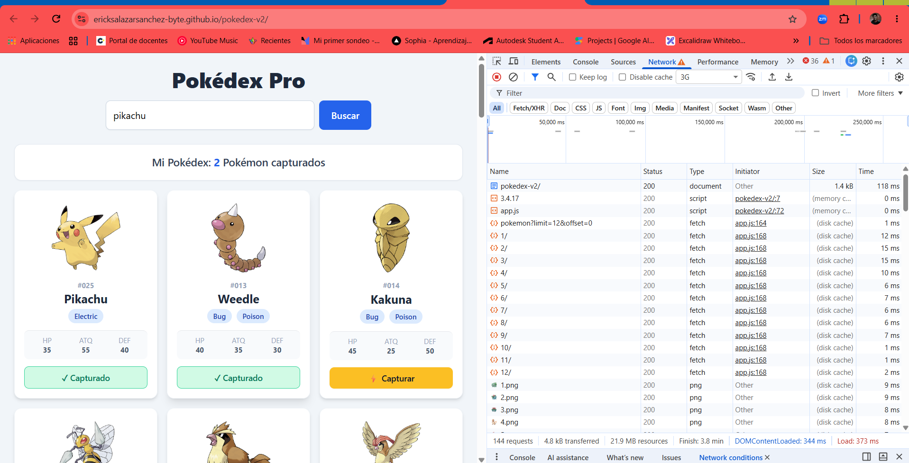

# Pokédex Pro - Aplicación Web Interactiva (Módulo 3)

Buscador de Pokémon dinámico y profesional desarrollado en JavaScript moderno (ES6+) que consume la API REST oficial **PokeAPI**[cite: 44, 48]. La aplicación incluye renderizado dinámico del DOM, asincronía con `async/await`, manejo robusto de errores HTTP (`404`) y estados visuales de UI (spinner de carga y mensajes dinámicos)[cite: 44, 47, 48].

## 🚀 Enlace al Proyecto Desplegado
[Ver Pokédex Pro en GitHub Pages](https://ericksalazarsanchez-byte.github.io/pokedex-v2/)

---

## 📸 Evidencias de Funcionamiento (Capturas)

### Estado Exitoso: Búsqueda y Renderizado Dinámico

### Estado de Carga: Spinner Animado ("Cargando...")

### Estado de Error: Detección de 404 y Botón Reintentar

---

## 📋 Historias de Usuario e Implementación Técnica

### HU1: Manejo de Errores Asíncronos con try/catch
**Como** usuario de la Pokédex,  
**quiero** ver un mensaje claro de aviso cuando ocurra un problema de red o de búsqueda,  
**para** evitar que la aplicación se rompa o se quede congelada y poder seguir interactuando con ella[cite: 45].

* **Implementación de Promesas / try-catch:**  
  La función asíncrona `buscarPokemonEnAPI()` envuelve el llamado a la API dentro de un bloque `try`. Si ocurre una falla de red (promesa rechazada o excepción), el bloque `catch` la atrapa para renderizar un mensaje claro en la UI mediante `mostrarError()` en lugar de romper la app en consola[cite: 45].

---

### HU2: Detección de Recurso No Encontrado (404) con throw
**Como** usuario de la Pokédex,  
**quiero** recibir una notificación explícita cuando busque un Pokémon inexistente (ej. "pikachuu"),  
**para** saber con exactitud que el nombre o ID ingresado no coincide con ningún registro de PokeAPI[cite: 46].

* **Implementación de Promesas / try-catch:**  
  En la función `obtenerPokemon()`, se evalúa la respuesta del `fetch`. Dado que una respuesta HTTP 404 no rechaza la promesa automáticamente, se valida `if (!response.ok)`. Si la respuesta es fallida, se lanza una excepción explícita con `throw new Error()` que interrumpe el `try` y envía el mensaje de error específico directamente al `catch`[cite: 46].

---

### HU3: Estado de Carga Visual con Spinner Animado de Tailwind
**Como** usuario de la Pokédex,  
**quiero** visualizar un indicador animado mientras se obtienen los datos de la web,  
**para** saber que la aplicación está procesando la solicitud y tener una buena experiencia visual[cite: 47, 49].

* **Implementación de Promesas / try-catch:**  
  Antes de iniciar la promesa asíncrona, se ejecuta `mostrarCargando()` para hacer visible el spinner. Al finalizar la operación de red, el bloque `finally` garantiza la ejecución de `ocultarCargando()`, asegurando que el spinner siempre desaparezca, tanto si la promesa se resuelve con éxito como si falla[cite: 47].

---

### HU4: Botón de Reintento de Búsqueda tras Error (Reto Adicional)
**Como** usuario afectado por un fallo de conexión o búsqueda,  
**quiero** presionar un botón de "Reintentar" directamente en la alerta de error,  
**para** ejecutar nuevamente la última búsqueda fallida de manera rápida y sin volver a escribir el texto[cite: 49].

* **Implementación de Promesas / try-catch:**  
  Cuando el bloque `catch` atrapa un error, además de renderizar el texto del mensaje, quita la clase `hidden` al botón `#btn-reintentar` y le asigna un event listener que invoca de nuevo a la función asíncrona `buscarPokemonEnAPI()` reutilizando la variable `ultimaBusqueda`[cite: 49].

---

## 🛠️ Tecnologías Utilizadas
* **JavaScript Moderno (ES6+):** `fetch`, `async/await`, `Promise.all`, `try/catch/finally`, `throw new Error`, `map()`, `filter()`, `find()`, destructuring y optional chaining[cite: 44, 46, 47, 48].
* **Tailwind CSS:** Diseño adaptativo, clases utilitarias (`grid`, `flex`, `hidden`) y animaciones nativas (`animate-spin`)[cite: 45, 48, 49].
* **PokeAPI REST Service:** Consumo de la API REST oficial de Pokémon (datos JSON en tiempo real)[cite: 48, 50].
* **Git / GitHub Pages:** Control de versiones en Git y despliegue público del proyecto[cite: 49, 51].